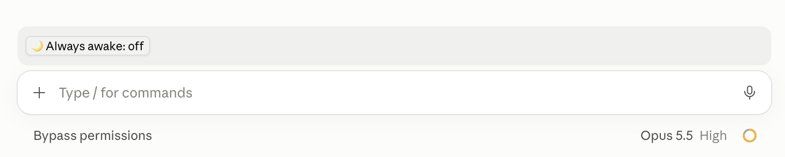

# claude-keep-awake

A Claude Code mod that keeps your Mac awake, **lid closed included**, from a button above the prompt or `/awake`.



> Unofficial community mod, not affiliated with Anthropic. macOS only. Built on the Claude Code Mods API (early access), tested with Claude Code 2.1.299.

It switches macOS's `pmset disablesleep`, which stops all system sleep until you turn it off, across restarts. The Claude desktop app's own "Keep computer awake while Claude works" setting prevents idle sleep while a session works; this covers the closed lid and the time in between, in the terminal and the desktop app alike.

The band above the prompt shows `☕ Always awake: on` (primary style) or `🌙 Always awake: off`. Click it to toggle.

## Install

At the prompt of a terminal session:

```
/plugin install keep-awake --marketplace gecitemre/claude-keep-awake
```

From a shell:

```bash
claude plugin install keep-awake --marketplace gecitemre/claude-keep-awake
```

In the desktop app: click + next to the prompt box, then Plugins, Add marketplace with `gecitemre/claude-keep-awake`, then Add plugin.

## Usage

```
/awake on               keep the Mac awake (pmset disablesleep 1)
/awake off              let it sleep again (pmset disablesleep 0)
/awake status           the real setting, whether a password is needed, the recorded original value
/awake restore          return to the value from before keep-awake first changed it
/awake setup            explain passwordless switching
/awake setup install    switch without a password from now on
/awake setup remove     ask for the password again
```

## Passwords

`pmset disablesleep` needs root. By default every change opens **macOS's own authentication dialog**: nothing is installed, no privilege stays behind, and the mod never sees your password.

To switch without the dialog, run `/awake setup install`. macOS asks for your password once, and the mod adds one file, `/etc/sudoers.d/keep-awake` (root, `0440`):

```
<you> ALL=(root) NOPASSWD: /usr/bin/pmset -a disablesleep 1, /usr/bin/pmset -a disablesleep 0
```

The file is checked with `visudo -cf` before it is installed and the whole configuration with `visudo -c` after; if that fails, the file is removed again. Nothing else in sudoers is touched. `/awake setup remove` deletes it.

## How state is read

- `disablesleep` is one **system-wide** value. `pmset -g` reports it as `SleepDisabled`; `pmset -g custom` lists only the per-power-source (AC, battery, UPS) settings and omits it.
- Each session listens for the `com.apple.system.powermanagement.prefschange` notification (`notifyutil -w`), which powerd posts whenever a pmset setting changes, so a change made in another session or a terminal shows in every band at once. No polling loop runs. The state is also re-read at session start, on every prompt and right before every change, so a toggle always acts on the real value.
- The setting is never turned off when Claude Code exits. Only `/awake off` or `/awake restore` changes it back.

## Uninstall

Run `/awake setup remove` first if you installed the passwordless rule, then:

```bash
claude plugin uninstall keep-awake
```

If the plugin is already gone, remove the rule by hand with `sudo rm /etc/sudoers.d/keep-awake`. Uninstalling leaves the sleep setting as it is; `sudo pmset -a disablesleep 0` turns it off.

## Security

- **Default (dialog):** no standing privilege. Each change needs your password, entered in macOS's dialog.
- **Passwordless rule:** your user can run exactly `/usr/bin/pmset -a disablesleep 1` and `… 0` as root without a password. sudo matches the full argument list, and `/usr/bin/pmset` is protected by System Integrity Protection, so no other command or argument gains root. The remaining risk: any process running as you (a script, a dependency, the model's Bash tool) can keep the Mac from sleeping with the lid closed, which can drain the battery or let a closed laptop overheat in a bag. It cannot read data or gain further privileges through this rule.

## Development

```bash
claude plugin validate .
```

```bash
claude plugin test .
```

## License

MIT
